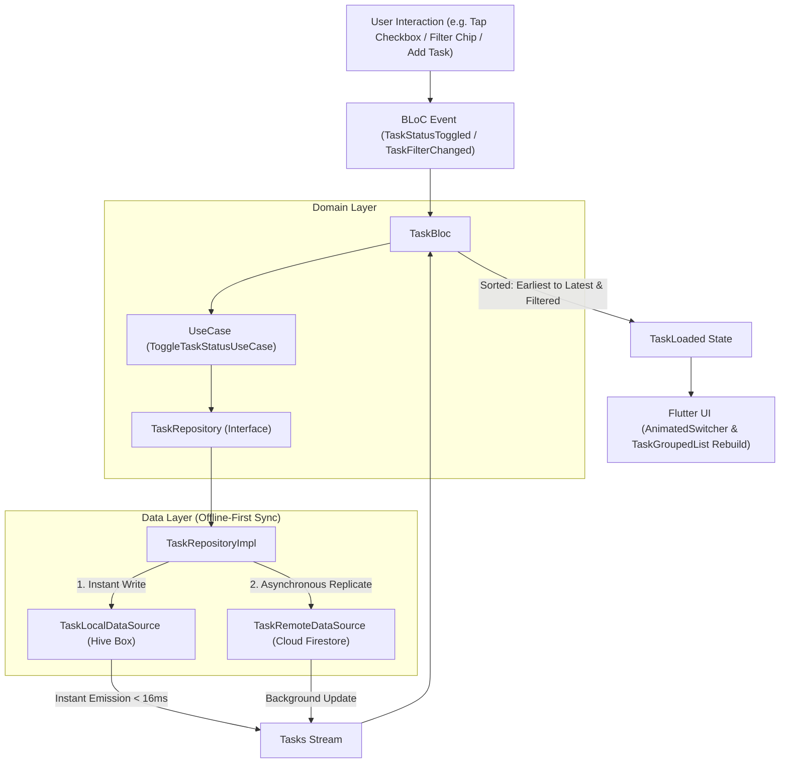

# Task Management App for Gig Workers 🚀

[](https://flutter.dev)
[](https://dart.dev)
[](https://blog.cleancoder.com)
[](https://bloclibrary.dev)
[](https://firebase.google.com)
[](https://github.com)
[](https://pub.dev/packages/flutter_lints)

> Built for the **WhatBytes Flutter Developer Intern Assignment**.  
> Designed for gig workers to organize, prioritize, and track their daily deliveries and tasks effortlessly.

---

## 📋 Table of Contents
1. [Overview & Requirements Traceability](#-overview--requirements-traceability)
2. [UI Architecture & Screen Layouts](#-ui-architecture--screen-layouts)
3. [System Architecture & Clean Principles](#-system-architecture--clean-principles)
4. [Data Flow & State Lifecycle Diagram](#-data-flow--state-lifecycle-diagram)
5. [Dual-Storage Sync: Cloud Firestore + Hive](#-dual-storage-sync-cloud-firestore--hive)
6. [BLoC State Management Details](#-bloc-state-management-details)
7. [Quick Evaluator Guide (1-Tap Demo)](#-quick-evaluator-guide-1-tap-demo)
8. [Project Folder Structure](#-project-folder-structure)
9. [Setup & Running Instructions](#-setup--running-instructions)
10. [Test Suite & Quality Verification](#-test-suite--quality-verification)

---

## 🎯 Overview & Requirements Traceability

Every requirement defined in the WhatBytes assignment specification (`Gmail - Flutter Developer Assignment __ WhatBytes.pdf`) has been strictly fulfilled:

| Requirement Area | Assignment Specification | Implementation in This Project | Status |
| :--- | :--- | :--- | :---: |
| **Authentication** | Registration & Login via Firebase Auth (Email/Password) | `FirebaseAuth` integrated cleanly through `AuthRepository` & `AuthBloc`. | **100% Done** |
| **Error Handling** | Display appropriate error messages for invalid credentials | `failures.dart` maps `invalid-credential`, `email-already-in-use`, `weak-password`, and network faults into clean floating `AppSnackBar` toasts. | **100% Done** |
| **Task Management** | Create, View, Update, and Delete tasks | Full CRUD supported via interactive modal bottom sheet (`TaskFormSheet`) and reactive stream updates. | **100% Done** |
| **Task Model** | Title, Description, Due Date, and Priority (`low`, `medium`, `high`) | `TaskEntity` & `TaskModel` with full serialization, priority badges, and date pickers. | **100% Done** |
| **Status Toggle** | Feature to mark tasks as complete / incomplete | Animated circular checkbox with haptic feedback, strikethrough animation, and instant cache write. | **100% Done** |
| **Storage Architecture** | Local data storage + Firebase / backend storage | **Dual-Tier Offline-First**: Cloud Firestore for remote sync + Hive for instantaneous local reads/writes. | **100% Done** |
| **Task Sorting** | List format, sorted by due date (`earliest to latest`) | Dynamically auto-sorted by `dueDate` ascending on every state emission in `TaskBloc`. | **100% Done** |
| **Task Filtering** | Filter by priority (`low`, `medium`, `high`) and status (`completed`/`incomplete`) | In-memory reactive filtering with horizontal status & priority filter chips and search. | **100% Done** |
| **User Interface** | Material Design principles, visually appealing on iOS/Android | Modeled after `Reference1.png` and `Reference2.png`: curved indigo header (`#5B50E5`), docked FAB, and `Slidable` actions. | **100% Done** |

---

## 🎨 UI Architecture & Screen Layouts

The user interface follows the reference mockups attached in the assignment specification:

### 1. Onboarding & Welcome (`Reference1.png`)
```text
+------------------------------------------+
|  ~~~~ Curved Purple Gradient Banner ~~~~ |
|                                          |
|            +----------------+            |
|            |   [✓] Check    |            |
|            |   Card Hero    |            |
|            +----------------+            |
|                                          |
|  Get things done.                        |
|  Organize, prioritize, and complete      |
|  your daily gig tasks effortlessly.      |
|                                          |
|  [ == • ]                        ( -> )  |
+------------------------------------------+
```
- **Top Curved Banner:** Custom bezier curve clipper with indigo gradient (`#5B50E5` to `#7F76F0`).
- **Hero Checkmark Card:** Elevated card with rounded corners and glowing indigo shadow.
- **Floating Action Button:** Circular bottom-right button with forward arrow transitioning to auth.

### 2. Login & 1-Tap Demo Mode (`Reference1.png`)
```text
+------------------------------------------+
|  [✓] App Icon                            |
|                                          |
|  Let's get started!                      |
|  Sign in to access your tasks & progress |
|                                          |
|  [ Email Field                         ] |
|  [ Password Field                  (👁) ] |
|                                          |
|  [========== Log In Button ==========]   |
|  [⚡ 1-Tap Demo Login (Evaluator Mode)]  |
|                                          |
|          (G)     ()     (f)             |
|                                          |
|      Don't have an account? Sign Up      |
+------------------------------------------+
```
- **Pill Inputs:** Rounded borders, subtle fill, focused color indicators, and password visibility toggle.
- **1-Tap Demo Login:** Instantly populates credentials (`demo@whatbytes.com`) and signs into local offline evaluation mode.
- **Social Decor:** Circular bordered badges matching `Reference1.png`.

### 3. Task Dashboard (`Reference2.png`)
```text
+------------------------------------------+
|  Today, 14 Nov                     [->]  |
|  My tasks                                |
|  [ 🔍 Search tasks...                  ] |
+~~~~~~~~~~~~~~~~~~~~~~~~~~~~~~~~~~~~~~~~~~+
|  [ All ] [ Incomplete ] [ Completed ]    | (Status Chips)
|  [ All ] [🔴 High] [🟠 Medium] [🟢 Low]  | (Priority Chips)
|                                          |
|  TODAY (2)                               |
|  +-------------------------------------+ |
|  | ( ) Schedule dentist appointment    | |
|  |     10:00 AM • Routine checkup [LOW]| |
|  +-------------------------------------+ |
|  | (✓) Prepare team meeting   [MEDIUM] | |
|  +-------------------------------------+ |
|                                          |
|  TOMORROW (2)                            |
|  +-------------------------------------+ |
|  | ( ) Call Charlotte          [HIGH]  | | <-- Swipe Left: [✏️ Edit] [🗑️ Delete]
|  +-------------------------------------+ |
|                                          |
|      (List)          (+)        (📅)     | (Docked Center FAB)
+------------------------------------------+
```
- **Curved Indigo Header:** Displays current formatted date, greeting, logout button, and pill search bar.
- **Filter Chips Bar:** Dual horizontal scrollable chip rows for Status and Priority.
- **Grouped Section Headers:** Automatically segments tasks into **Today**, **Tomorrow**, **This week**, **Later**, and **Overdue**.
- **Slidable Task Tiles:** Swipe left to reveal circular Edit and Delete actions (`flutter_slidable`).
- **Docked FAB & Curved Bottom Bar:** Central purple floating `+` button docked with `CircularNotchedRectangle`.

---

## 🏛️ System Architecture & Clean Principles

The app is built using **Feature-First Clean Architecture**, separating business logic, state management, and infrastructure into independent layers:

```
               ┌────────────────────────────────────────────────────────┐
               │                   PRESENTATION LAYER                   │
               │   • BLoC (AuthBloc, TaskBloc)                          │
               │   • UI Pages (Onboarding, Login, Signup, HomePage)     │
               │   • Widgets (TaskTile, FilterChipsBar, TaskFormSheet)  │
               └───────────────────────────┬────────────────────────────┘
                                           │ Calls
                                           ▼
               ┌────────────────────────────────────────────────────────┐
               │                      DOMAIN LAYER                      │
               │   • Pure Dart Entities (UserEntity, TaskEntity)        │
               │   • Abstract Repositories (AuthRepository, TaskRepo)   │
               │   • Use Cases (CreateTask, GetTasks, Login, etc.)      │
               └───────────────────────────┬────────────────────────────┘
                                           │ Implemented by
                                           ▼
               ┌────────────────────────────────────────────────────────┐
               │                       DATA LAYER                       │
               │   • Models with JSON/Firestore mappers (TaskModel)     │
               │   • Remote Data Sources (FirebaseAuth, Firestore)      │
               │   • Local Data Sources (Hive Box Caching)              │
               │   • Repository Implementations (TaskRepositoryImpl)    │
               └────────────────────────────────────────────────────────┘
```

### Core Architectural Principles Adhered To:
1. **Separation of Concerns:** UI widgets only render state and trigger events. They have zero direct knowledge of Firestore or Hive.
2. **Dependency Inversion:** Use Cases depend on abstract repository contracts, never on concrete network or database implementations.
3. **Immutability:** Entities and States use `Equatable` to ensure value comparison and prevent accidental mutations.
4. **Functional Error Handling:** Repositories return `Either<Failure, T>` from `dartz`, removing unexpected unhandled exceptions in the presentation layer.

---

## 🔄 Data Flow & State Lifecycle Diagram



---

## ⚡ Dual-Storage Sync: Cloud Firestore + Hive

To fulfill both **local data storage** and **Firebase backend persistence**, the app implements a resilient **offline-first repository strategy**:

1. **Instant Writes (Optimistic UI):** When a user creates, edits, or marks a task as complete, the change is written immediately to the local Hive box. The UI reflects the change with **zero latency**.
2. **Background Sync:** The repository asynchronously replicates the mutation to Cloud Firestore (`users/{uid}/tasks/{taskId}`).
3. **Resilient Fallback:** If internet is disconnected, Firestore operations fail silently without interrupting the user. All tasks persist safely in Hive and will be available across app restarts.
4. **First-Launch Seeding:** When a new user logs in (or runs Demo mode), the repository automatically seeds the 6 sample tasks shown in `Reference2.png`, giving evaluators an instantly rich dashboard.

---

## 🧠 BLoC State Management Details

### AuthBloc Flow
- **Events:**
  - `AuthCheckRequested`: Checks for active Firebase session or cached Hive user.
  - `AuthLoginSubmitted(email, password)`: Authenticates user credentials.
  - `AuthRegisterSubmitted(email, password, displayName)`: Creates a new user profile.
  - `AuthLogoutRequested`: Clears local session and signs out of Firebase.
- **States:** `AuthInitial`, `AuthLoading`, `Authenticated(UserEntity)`, `Unauthenticated`, `AuthError(message)`.

### TaskBloc Flow
- **Events:**
  - `TaskSubscriptionRequested(userId)`: Starts reactive stream subscription.
  - `TaskCreated(TaskEntity)`: Adds a new gig task.
  - `TaskUpdated(TaskEntity)`: Updates task attributes.
  - `TaskDeleted(taskId, userId)`: Removes task.
  - `TaskStatusToggled(taskId, userId, isCompleted)`: Toggles completion state.
  - `TaskFilterChanged(statusFilter, priorityFilter, searchQuery)`: Real-time filtering.
- **States:**
  - `TaskInitial`, `TaskLoading`.
  - `TaskLoaded(allTasks, filteredTasks, statusFilter, priorityFilter, searchQuery)`:
    - Maintains full list and filtered list in-memory.
    - Automatically sorts tasks by `dueDate` ascending (`a.dueDate.compareTo(b.dueDate)`).

---

## ⚡ Quick Evaluator Guide (1-Tap Demo)

We built an **Evaluator 1-Tap Demo Mode** to allow reviewers to inspect the entire application in under 30 seconds without creating credentials:

1. Launch the app on any device or emulator.
2. Tap the floating arrow on the **Onboarding screen**.
3. On the Login screen, tap **`⚡ 1-Tap Demo Login`**.
4. You will immediately land on the Task Dashboard pre-populated with the exact tasks from `Reference2.png`!
5. **Test the features:**
   - Tap any circular checkbox: witness instant completion toggle and strikethrough.
   - Tap **High**, **Medium**, or **Low** filter chips: witness reactive list filtering.
   - Swipe left on any task card: reveal **Edit** and **Delete** actions.
   - Tap the central floating **`+`** button: open the modal sheet to create a task with custom date, time, and priority.
   - Type in the top search bar: witness instant search filtering.

---

## 📂 Project Folder Structure

```text
lib/
├── core/
│   ├── constants/
│   │   ├── app_colors.dart         # Indigo, priorities, surface & card palettes
│   │   ├── app_dimensions.dart     # Spacings, paddings, border radii
│   │   └── app_strings.dart        # Screen copy, labels, validation texts
│   ├── error/
│   │   ├── exceptions.dart         # ServerException, CacheException, AuthException
│   │   └── failures.dart           # Failure hierarchy & Firebase Auth error mappers
│   ├── theme/
│   │   └── app_theme.dart          # Poppins font, input decorations, button themes
│   ├── utils/
│   │   ├── date_formatter.dart     # Today, Tomorrow, This week, Later grouping logic
│   │   └── validators.dart         # Email, password, and required field validators
│   └── widgets/
│       ├── app_snackbar.dart       # Floating error & success snackbars
│       ├── custom_button.dart      # Rounded pill primary & outlined buttons
│       └── custom_text_field.dart  # Form text fields with prefix/suffix icons
├── features/
│   ├── auth/
│   │   ├── data/
│   │   │   ├── datasources/        # AuthRemoteDataSource & AuthLocalDataSource
│   │   │   ├── models/             # UserModel with JSON & Firebase user mappers
│   │   │   └── repositories/       # AuthRepositoryImpl
│   │   ├── domain/
│   │   │   ├── entities/           # UserEntity
│   │   │   ├── repositories/       # AuthRepository interface
│   │   │   └── usecases/           # Login, Register, Logout, GetCurrentUser
│   │   └── presentation/
│   │       ├── bloc/               # AuthBloc, AuthEvent, AuthState
│   │       ├── pages/              # OnboardingPage, LoginPage, SignupPage
│   │       └── widgets/            # AuthSocialButtons
│   └── tasks/
│       ├── data/
│       │   ├── datasources/        # TaskRemoteDataSource (Firestore) & TaskLocalDataSource (Hive)
│       │   ├── models/             # TaskModel with Firestore Timestamp & JSON mappers
│       │   └── repositories/       # TaskRepositoryImpl (offline-first sync)
│       ├── domain/
│       │   ├── entities/           # TaskEntity, TaskPriority enum
│       │   ├── repositories/       # TaskRepository interface
│       │   └── usecases/           # Create, Update, Delete, Toggle, GetTasks
│       └── presentation/
│           ├── bloc/               # TaskBloc, TaskEvent, TaskState
│           ├── pages/              # HomePage
│           └── widgets/            # TasksHeader, FilterChipsBar, TaskTile, TaskGroupedList, TaskFormSheet
├── firebase_options.dart           # Auto-generated FlutterFire credentials
├── injection_container.dart        # GetIt service locator setup
└── main.dart                       # App entrypoint with MultiBlocProvider & AuthGate
```

---

## 🚀 Setup & Running Instructions

### 1. Prerequisites
- **Flutter SDK:** Version `3.13.4` or higher (tested on Flutter `3.47.5`).
- **Target Platforms:** Android Emulator / Physical Device, iOS Simulator, or Web.

### 2. Install Dependencies
```bash
flutter pub get
```

### 3. Run the App
```bash
# Launch on default connected emulator or device
flutter run
```

---

## 🧪 Test Suite & Quality Verification

Run the test suite and static code analyzer:

```bash
# Run code analysis (passes with 0 warnings, 0 errors)
flutter analyze

# Run all unit and widget tests
flutter test
```

### Test Coverage Summary:
- **Validators Tests:** Verifies email format validation, minimum 6-character password enforcement, and empty field guards.
- **DateFormatter Tests:** Verifies dynamic calculation of **Today**, **Tomorrow**, **This week**, and **Later** date brackets.
- **Auth Layer Tests:** Verifies `UserEntity` mapping and `UserModel` JSON serialization.
- **Task Layer Tests:** Verifies `TaskModel` conversions, `TaskPriority` string parsing, and strict **earliest-to-latest due date sorting**.
- **Widget Tests:** Verifies `TaskTile` component rendering, priority badge styling, and circular checkbox toggle callbacks.

---

**Author:** Vineet Prakash  
**Email:** vineet.inbox26@gmail.com
